*Mermaid diagrams are provided as fenced code blocks. The Markdown file holds the same source.*

# 03 — Application Flow Specification

| **Field**           | **Value**                                                                                                  |
|---------------------|------------------------------------------------------------------------------------------------------------|
| Document            | 03 — Application Flow Specification                                                                        |
| Version             | 1.0 (documentation baseline)                                                                               |
| Date                | 16 October 2026                                                                                            |
| Status              | Draft; no flow is implemented or tested by this document                                                   |
| Authoring role      | Senior Systems Analyst, reviewed by Principal Software Architect                                           |
| Companion documents | 01 PRD, 02 TRD (component names and section numbers), 05 Backend Schema (state and entity names), 04 UI/UX |
| Diagram syntax      | Mermaid. Each diagram is also preserved as source in this Markdown file.                                   |

## Contents

1\. Conventions

2\. Main flows (27)

3\. Edge-case flows (20)

4\. Failure-case matrix

5\. Mermaid diagrams (14)

6\. Overall sequence

## 1. Conventions

- **Actors:** Evaluator (user), Dashboard (Next.js), API (FastAPI), Orchestrator, Governor, Registry client (Brreg), Plan B reader (Proff.no, gated), Scraper, Evidence vault, LLM service, Validators, Confidence engine, Store, Event bus, Change Radar.

- **States** use the names defined in 05 (job, company and fact statuses).

- **Flags** are persisted on the dossier or company record exactly as the manual names them (p.7, p.9, p.17, p.18): website_unreachable, time_limit_registry_only, request_brake, llm_skipped, financials_unavailable, not_processed_budget, conflicts_with_registry, time_relative, self_reported, quote_translated, quote_not_found.

- **Budget reservations** happen before every outbound call (TRD §13.2). Diagrams label them "reserve".

- Flow references use section numbers of the source manual (for example "p.13") and of the TRD.

## 2. Main flows (27)

Each flow lists its trigger, ordered steps, components involved, and the persisted outcome.

### F01 — Application startup

| **Item**   | **Detail**                                                                                                                                                                                                                                                                                        |
|------------|---------------------------------------------------------------------------------------------------------------------------------------------------------------------------------------------------------------------------------------------------------------------------------------------------|
| Trigger    | make run (Lite) or docker compose up (Full)                                                                                                                                                                                                                                                       |
| Steps      | 1\. Load .env and environment. 2. Validate configuration (F02). 3. Initialise Governor with zero counters (or restore from latest checkpoint if resuming). 4. Start workers (idle). 5. Start API and event bus. 6. Start dashboard (Full) or serve dashboard build (Lite). 7. Expose /api/health. |
| Components | Config validator, Governor, Orchestrator, API                                                                                                                                                                                                                                                     |
| Outcome    | Service ready; health shows mode and config status. Startup failure exits non-zero with missing variable names.                                                                                                                                                                                   |

### F02 — Configuration validation

| **Item**   | **Detail**                                                                                                                                                                                                                                                                                                                              |
|------------|-----------------------------------------------------------------------------------------------------------------------------------------------------------------------------------------------------------------------------------------------------------------------------------------------------------------------------------------|
| Trigger    | Startup and /api/health                                                                                                                                                                                                                                                                                                                 |
| Steps      | 1\. Check required variables for mode. 2. Check limit ordering: brake ≤ 2,000; soft cap \< brake; kill-switch trip \< hard stop ≤ 45. 3. Check LLM key presence; if absent, set llm_skipped mode for all runs (registry-only, p.11). 4. Check PLAN_B_ENABLED requires the ADR-06 terms record. 5. Check Playwright binary when enabled. |
| Components | Config validator                                                                                                                                                                                                                                                                                                                        |
| Outcome    | Config status valid, valid_with_warnings, or invalid. Invalid stops startup.                                                                                                                                                                                                                                                            |

### F03 — Input submission

| **Item**   | **Detail**                                                                                                                                                                                                                              |
|------------|-----------------------------------------------------------------------------------------------------------------------------------------------------------------------------------------------------------------------------------------|
| Trigger    | User pastes numbers or uploads file on Command Center (p.19), or CLI INPUT= (p.13)                                                                                                                                                      |
| Steps      | 1\. Dashboard sends text or file to E1 for live validation. 2. Validation results shown (accepted count, rejected lines). 3. User presses Start; dashboard sends E2 with accepted orgnrs. 4. Server re-validates (never trusts client). |
| Components | Dashboard, API, Input processor                                                                                                                                                                                                         |
| Outcome    | Validated list ready for job creation.                                                                                                                                                                                                  |

### F04 — TXT/CSV parsing

| **Item**   | **Detail**                                                                                                                                                                                                                                                                                                                        |
|------------|-----------------------------------------------------------------------------------------------------------------------------------------------------------------------------------------------------------------------------------------------------------------------------------------------------------------------------------|
| Trigger    | File upload or INPUT file path                                                                                                                                                                                                                                                                                                    |
| Steps      | 1\. Reject files \> 1 MB (413). 2. Decode UTF-8 (reject otherwise, 415). 3. TXT: one value per line; trim whitespace; ignore blank lines. 4. CSV: standard CSV parser; select the first column whose values are 9-digit strings (rule to be confirmed, OQ-03); if none, reject the file. 5. Preserve leading zeros (string type). |
| Components | Input processor                                                                                                                                                                                                                                                                                                                   |
| Outcome    | Candidate list with line references.                                                                                                                                                                                                                                                                                              |

### F05 — Company-number validation

| **Item**   | **Detail**                                                                                                                                                                                                       |
|------------|------------------------------------------------------------------------------------------------------------------------------------------------------------------------------------------------------------------|
| Trigger    | Each candidate value                                                                                                                                                                                             |
| Steps      | 1\. Strip spaces and separators (only if they are spaces or hyphens between groups, not letters). 2. Check exactly 9 digits (length_not_9, non_digit). 3. Apply MOD-11 check (mod11_checksum_failed). 4. Accept. |
| Components | Input processor (orgnr_checksum)                                                                                                                                                                                 |
| Outcome    | Accepted or rejected with reason. No outbound request in either case.                                                                                                                                            |

Note: the MOD-11 algorithm and its weights are defined in the implementation, and its test vectors must be recorded (TA-01). The manual describes the check only as "a built-in spelling check" (p.13).

### F06 — Duplicate detection

| **Item**   | **Detail**                                                                                                                                                                 |
|------------|----------------------------------------------------------------------------------------------------------------------------------------------------------------------------|
| Trigger    | After validation, before job creation                                                                                                                                      |
| Steps      | 1\. Remove duplicates within the submission (AS-07), record count. 2. Look up each orgnr in the store. 3. Mark known (previously processed) for Change Radar; do not skip. |
| Components | Input processor, Store                                                                                                                                                     |
| Outcome    | Accepted list annotated with known flags.                                                                                                                                  |

### F07 — Job creation

| **Item**   | **Detail**                                                                                                                                                                                          |
|------------|-----------------------------------------------------------------------------------------------------------------------------------------------------------------------------------------------------|
| Trigger    | E2 accepted                                                                                                                                                                                         |
| Steps      | 1\. Check Idempotency-Key (TRD §17.3). 2. Create ProcessingJob (queued) and JobCompany rows (pending). 3. Initialise Governor counters for the job. 4. Emit job.started. 5. Return 202 with job_id. |
| Components | API, Orchestrator, Store, Governor                                                                                                                                                                  |
| Outcome    | Job queued; events flowing.                                                                                                                                                                         |

### F08 — Worker scheduling

| **Item**   | **Detail**                                                                                                                                                                                    |
|------------|-----------------------------------------------------------------------------------------------------------------------------------------------------------------------------------------------|
| Trigger    | Job started                                                                                                                                                                                   |
| Steps      | 1\. Enqueue all accepted orgnrs. 2. Start 8 workers. 3. Each worker takes one company, marks it pass1_running. 4. When Pass 1 queue is empty and all workers idle, job moves to Pass 2 (F12). |
| Components | Orchestrator, Worker pool                                                                                                                                                                     |
| Outcome    | Companies processed concurrently. Max 8 in flight.                                                                                                                                            |

### F09 — Pass 1 registry processing

| **Item**   | **Detail**                                                                                                                                                                                                                                                                                                                                                                                                                         |
|------------|------------------------------------------------------------------------------------------------------------------------------------------------------------------------------------------------------------------------------------------------------------------------------------------------------------------------------------------------------------------------------------------------------------------------------------|
| Trigger    | Worker takes a company                                                                                                                                                                                                                                                                                                                                                                                                             |
| Steps      | 1\. Reserve 1 request; GET main record. 2. If 404: reserve 1; GET sub-unit. 3. If still not found: status not_found; base profile (no registry facts) is not created; continue to F10 only if a record exists. 4. Store RegistryRecord with raw hash and JSON paths. 5. Reserve 1; GET roles; store CompanyRole entries (names and roles). 6. Reserve; GET accounts (F10). 7. Build base profile and save. 8. Mark pass1_complete. |
| Components | Registry client, Governor, Store                                                                                                                                                                                                                                                                                                                                                                                                   |
| Outcome    | Base profile (or not_found, deleted, bankrupt status as a valid fact).                                                                                                                                                                                                                                                                                                                                                             |

### F10 — Financial-data processing

| **Item**   | **Detail**                                                                                                                                                                                                                                                                                                                                                                                                                                                                                  |
|------------|---------------------------------------------------------------------------------------------------------------------------------------------------------------------------------------------------------------------------------------------------------------------------------------------------------------------------------------------------------------------------------------------------------------------------------------------------------------------------------------------|
| Trigger    | Step 6 of F09                                                                                                                                                                                                                                                                                                                                                                                                                                                                               |
| Steps      | 1\. Plan A: reserve; GET accounts. 2. 200: parse; store FinancialRecord (method registry, currency, unit, year); latest year only. 3. 404 (no accounts filed): record no_accounts_filed; no Plan B. 4. Timeout, 5xx, connection error or format change: record outage signal; increment consecutive counter. 5. Counter ≥ 3: switch to Plan B for remaining companies (F11); start 5-minute retest timer. 6. Plan B enabled and needed: F11. 7. Otherwise: Plan C (financials_unavailable). |
| Components | Registry client, Financial reader, Governor                                                                                                                                                                                                                                                                                                                                                                                                                                                 |
| Outcome    | FinancialRecord with method and source, or unavailable with reason.                                                                                                                                                                                                                                                                                                                                                                                                                         |

### F11 — Plan B reader (financial fallback)

| **Item**   | **Detail**                                                                                                                                                                                                                                                                                                                                                                                                                                                                                                                                                                      |
|------------|---------------------------------------------------------------------------------------------------------------------------------------------------------------------------------------------------------------------------------------------------------------------------------------------------------------------------------------------------------------------------------------------------------------------------------------------------------------------------------------------------------------------------------------------------------------------------------|
| Trigger    | Plan A outage state and PLAN_B_ENABLED=true                                                                                                                                                                                                                                                                                                                                                                                                                                                                                                                                     |
| Steps      | 1\. Reserve (≤ 2 requests per company). 2. Fetch Proff.no company page for the orgnr. 3. Check org number on page equals orgnr exactly; else abstain (org_mismatch). 4. Locate fixed fields (for example revenue, result, equity). 5. Check unit is explicit on page; else abstain (unit_unclear). 6. Check fiscal year is printed; select latest. 7. Save snapshot; confirm exact cell text exists in saved page; else abstain (value_not_in_page). 8. Store FinancialRecord with method structured_fallback, source proff.no, S = 0.7. 9. Pass through Q and V checks (p.16). |
| Components | Financial reader, Scraper (snapshot), Evidence vault, Validators                                                                                                                                                                                                                                                                                                                                                                                                                                                                                                                |
| Outcome    | Financial values with full provenance, or abstention.                                                                                                                                                                                                                                                                                                                                                                                                                                                                                                                           |

### F12 — Pass 2 website extraction (entry)

| **Item**   | **Detail**                                                                                                                                                                                                                                                                                       |
|------------|--------------------------------------------------------------------------------------------------------------------------------------------------------------------------------------------------------------------------------------------------------------------------------------------------|
| Trigger    | Pass 2 begins                                                                                                                                                                                                                                                                                    |
| Steps      | 1\. For each company with a registry website, queue for Pass 2. 2. Companies without a website: status registry_only, reason no_website; no requests (p.17). 3. Companies with not_found or without base profile: skip to terminal (not_processed_budget if budget brake; else no_base_profile). |
| Components | Orchestrator                                                                                                                                                                                                                                                                                     |
| Outcome    | Pass 2 queue.                                                                                                                                                                                                                                                                                    |

### F13 — Website extraction

Covered in detail in Section 5, diagram D6. Summary: validate URL (SSRF, TRD §19.3); reserve; fetch homepage with httpx (8 s, 2 retries); discover up to 2 About/Contact pages; each hop reserved and revalidated; empty-page check triggers Playwright per SC-01 setting; clean text; snapshot with SHA-256.

### F14 — AI-assisted extraction

Covered in D7. Summary: build prompt (page text in delimiters); reserve LLM slot in the 30-per-minute sliding window; call with temperature 0; Instructor validates schema; one retry if invalid; empty list recorded as no_candidate_facts.

### F15 — Quote verification

Covered in D7. Summary: normalise; fuzzy match in saved page; score \< 0.95 → Q = 0; failure → one repair call (reserved) → if still failing: quote_translated (quote language ≠ page language) or quote_not_found.

### F16 — Identity verification

| **Item**   | **Detail**                                                                                                                                                                                                                                                                                                                                      |
|------------|-------------------------------------------------------------------------------------------------------------------------------------------------------------------------------------------------------------------------------------------------------------------------------------------------------------------------------------------------|
| Trigger    | Once per page, before facts are scored                                                                                                                                                                                                                                                                                                          |
| Steps      | 1\. Compare page domain to registry official domain (domain must match or be a subdomain; off-domain redirects excluded). 2. Score: +0.6 domain; +0.25 org number on page; +0.15 legal name and town on page. 3. Apply stricter rule (TRD §11.4): domain AND (org number OR name+town). 4. G = 1 if rule satisfied and score ≥ 0.6, else G = 0. |
| Components | Validators (identity lock)                                                                                                                                                                                                                                                                                                                      |
| Outcome    | G value per page; G = 0 rejects all facts from the page (identity_failed).                                                                                                                                                                                                                                                                      |

### F17 — Money filtering

Covered in D7. Summary: detect numbers in value and quote; money test (currency tokens and money words within 6 words); block money numbers unless from registry or Plan B; allow harmless numbers when digits appear in quote; apply to other_key_fact too.

### F18 — Confidence calculation

Covered in D8. Summary: compute 0.6 × S + 0.4 × F; multiply by Q, V, G; compare with 0.80.

### F19 — Fact acceptance or rejection

| **Item**   | **Detail**                                                                                                                                                                                                              |
|------------|-------------------------------------------------------------------------------------------------------------------------------------------------------------------------------------------------------------------------|
| Trigger    | Confidence computed                                                                                                                                                                                                     |
| Steps      | 1\. Confidence ≥ 0.80: create PublishedFact with all components and tags; status published. 2. Otherwise: create RejectionRecord with first failing stage and reason code. 3. Emit company.validator event with counts. |
| Components | Confidence engine, Store, Event bus                                                                                                                                                                                     |
| Outcome    | Fact published or rejected; both recorded.                                                                                                                                                                              |

### F20 — Dossier publication

Covered in D12. Summary: after all pages of a company complete, assemble dossier from registry data, financials and published facts; compute verified_fact_count; write dossier (upsert by orgnr); append to dossiers.jsonl (Lite) or update MongoDB (Full); emit company.finished.

### F21 — Evidence storage

| **Item**   | **Detail**                                                                                                                                                                                                                                                          |
|------------|---------------------------------------------------------------------------------------------------------------------------------------------------------------------------------------------------------------------------------------------------------------------|
| Trigger    | Every fetched page and every raw LLM response                                                                                                                                                                                                                       |
| Steps      | 1\. Compute SHA-256 of normalised text. 2. Write text to data/snapshots/{sha256}.txt (immutable; if exists, reuse). 3. Write metadata: source URL, final URL, HTTP status, content type, retrieval time (UTC), byte size. 4. Link snapshot to company and to facts. |
| Components | Evidence vault, Store                                                                                                                                                                                                                                               |
| Outcome    | Evidence reference used by Evidence Viewer and replay.                                                                                                                                                                                                              |

### F22 — Live dashboard updates

| **Item**   | **Detail**                                                                                                                                                                                                              |
|------------|-------------------------------------------------------------------------------------------------------------------------------------------------------------------------------------------------------------------------|
| Trigger    | Any event                                                                                                                                                                                                               |
| Steps      | 1\. Event written to ring buffer and events.jsonl. 2. SSE stream sends event with monotonic id. 3. Client appends to Terminal; updates meters on budget.update. 4. On disconnect, client reconnects with Last-Event-ID. |
| Components | Event bus, API (SSE), Dashboard                                                                                                                                                                                         |
| Outcome    | Live Terminal and meters updated (p.19).                                                                                                                                                                                |

### F23 — Change detection

| **Item**   | **Detail**                                                                                                                                                                                                                                                                                                                  |
|------------|-----------------------------------------------------------------------------------------------------------------------------------------------------------------------------------------------------------------------------------------------------------------------------------------------------------------------------|
| Trigger    | Start of a run that includes known companies (Change Radar; later release)                                                                                                                                                                                                                                                  |
| Steps      | 1\. Fetch Brreg updates feed (reserve). 2. Intersect with known orgnrs. 3. For changed companies: re-run Pass 1 (registry) and Pass 2 for changed pages only (hash comparison). 4. Compare new values with previous; write ChangeRecord with previous and new values, source and time. 5. Keep previous profile and hashes. |
| Components | Change Radar, Registry client, Scraper, Store                                                                                                                                                                                                                                                                               |
| Outcome    | ChangeRecords; Change Feed updated.                                                                                                                                                                                                                                                                                         |

### F24 — Budget exhaustion (soft cap, then brake)

| **Item**      | **Detail**                                                                                                                                                                                                                                                                                                                                                                                                                                                                                                                                                                                                                                                                                                                                                                                                                                                                                                                                                                                                                                                                                                                                                                                                                                                                                                                                                                                                                                                                                                                                                                                                                                                                         |
|---------------|------------------------------------------------------------------------------------------------------------------------------------------------------------------------------------------------------------------------------------------------------------------------------------------------------------------------------------------------------------------------------------------------------------------------------------------------------------------------------------------------------------------------------------------------------------------------------------------------------------------------------------------------------------------------------------------------------------------------------------------------------------------------------------------------------------------------------------------------------------------------------------------------------------------------------------------------------------------------------------------------------------------------------------------------------------------------------------------------------------------------------------------------------------------------------------------------------------------------------------------------------------------------------------------------------------------------------------------------------------------------------------------------------------------------------------------------------------------------------------------------------------------------------------------------------------------------------------------------------------------------------------------------------------------------------------|
| Trigger       | BudgetLedger total reaches 1,700 (soft) or 1,950 (brake)                                                                                                                                                                                                                                                                                                                                                                                                                                                                                                                                                                                                                                                                                                                                                                                                                                                                                                                                                                                                                                                                                                                                                                                                                                                                                                                                                                                                                                                                                                                                                                                                                           |
| Steps (soft)  | 1\. Emit budget.soft_cap. 2. Deny optional reservations (Playwright, About/Contact, Plan B). 3. Cheap steps continue.                                                                                                                                                                                                                                                                                                                                                                                                                                                                                                                                                                                                                                                                                                                                                                                                                                                                                                                                                                                                                                                                                                                                                                                                                                                                                                                                                                                                                                                                                                                                                              |
| Steps (brake) | 1\. Set brake_tripped (permanent for the run).<br>2. Deny all outbound reservations (scraping, Plan B, registry, LLM). Requests already in flight may complete.<br>3. Classify every company that has not reached a terminal status, by what it holds at the moment the brake trips. Exactly one of the following applies:<br>(a) No Pass 1 profile: set not_processed_budget.<br>(b) Pass 1 profile and ZERO fetched AI facts (Pass 2 not started, queued, or mid-flight with nothing fetched yet): set status registry_only with the request_brake flag. No validation step applies because there is nothing to validate.<br>(c) Pass 2 mid-flight and ONE OR MORE AI facts already fetched: go to step 4. The company is not downgraded to registry_only.<br>4. For each company in (c), validate the fetched facts locally with no outbound requests (Quote, Value and Identity gates passed, score at least 0.80). Save every fact that passes and set the company status to published with the request_brake flag, which denotes partial enrichment (the dossier holds the facts fetched before the brake, not the full Pass 2 set). Facts that fail validation are rejected and recorded as usual. If no fetched fact passes validation, the company has zero publishable AI facts and is set to registry_only with the request_brake flag, as in (b).<br>5. Emit budget.brake.<br>6. Write stop reason request_brake to the run report.<br>Flag reading rule: request_brake on a registry_only company means no AI facts were obtained. request_brake on a published company means partial enrichment. verified_fact_count counts only the published facts in either case. |
| Components    | Governor, Orchestrator                                                                                                                                                                                                                                                                                                                                                                                                                                                                                                                                                                                                                                                                                                                                                                                                                                                                                                                                                                                                                                                                                                                                                                                                                                                                                                                                                                                                                                                                                                                                                                                                                                                             |
| Outcome       | Partial results with flags. Companies with zero fetched AI facts end as registry_only (request_brake); companies with fetched and validated facts end as published (request_brake, partial enrichment); companies without a Pass 1 profile end as not_processed_budget.                                                                                                                                                                                                                                                                                                                                                                                                                                                                                                                                                                                                                                                                                                                                                                                                                                                                                                                                                                                                                                                                                                                                                                                                                                                                                                                                                                                                            |

### F25 — Time kill switch

| **Item**   | **Detail**                                                                                                                                                                                                                                                                                                                                                                  |
|------------|-----------------------------------------------------------------------------------------------------------------------------------------------------------------------------------------------------------------------------------------------------------------------------------------------------------------------------------------------------------------------------|
| Trigger    | After each finished company, once 10 are finished (p.9)                                                                                                                                                                                                                                                                                                                     |
| Steps      | 1\. Compute elapsed (monotonic). 2. Compute recent speed = companies finished per minute over last 10 completions. 3. Projection = elapsed + remaining ÷ recent speed. 4. If projection \> 38 min: trip. 5. Trip: disable Playwright; cancel open Playwright pages; set flag for waiting companies time_limit_registry_only; keep trip for run. 6. Emit killswitch.tripped. |
| Components | Time kill switch, Scraper, Governor                                                                                                                                                                                                                                                                                                                                         |
| Outcome    | Remaining Pass 2 companies finish registry-only.                                                                                                                                                                                                                                                                                                                            |

Detail in D10.

### F26 — Emergency brake

Covered in D9. Summary: see F24 brake steps.

### F27 — Checkpoint recovery

| **Item**   | **Detail**                                                                                                                                                                                                                                                                                                                                         |
|------------|----------------------------------------------------------------------------------------------------------------------------------------------------------------------------------------------------------------------------------------------------------------------------------------------------------------------------------------------------|
| Trigger    | Process restart or operator resume                                                                                                                                                                                                                                                                                                                 |
| Steps      | 1\. Load latest checkpoint for job. 2. Verify checkpoint hash and file list. 3. Restore Governor counters (do not reset). 4. Skip companies in terminal status. 5. Re-queue non-terminal companies at their last completed step (Pass 1 company → restart Pass 1 for that company; Pass 2 company → restart Pass 2 for that company). 6. Continue. |
| Components | Orchestrator, Store, Governor                                                                                                                                                                                                                                                                                                                      |
| Outcome    | No duplicate processing of terminal companies; counters continue.                                                                                                                                                                                                                                                                                  |

Note: a company interrupted mid-step may re-run that step; requests for the re-run are reserved again. Pass 1 profiles already saved are not recomputed unless their status is incomplete.

### F28 — Replay execution (later release)

Covered in D13. Summary: load job's recorded inputs and evidence; disable network; read LLM responses from storage; run pipeline with recorded timestamps; compare outputs.

### F29 — Final run report

| **Item**   | **Detail**                                                                                                                                                                                                   |
|------------|--------------------------------------------------------------------------------------------------------------------------------------------------------------------------------------------------------------|
| Trigger    | Job reaches a final stop condition (TRD §13.9)                                                                                                                                                               |
| Steps      | 1\. Stop workers gracefully (no new reservations). 2. Finish validation of saved facts. 3. Compute totals from ledger. 4. Write run_report.json and final checkpoint. 5. Emit job.finished with stop_reason. |
| Components | Orchestrator, Reporting, Store                                                                                                                                                                               |
| Outcome    | Report available at E10.                                                                                                                                                                                     |

*Note: the manual lists 27 flows implicitly through the steps on p.13 and p.17; this section numbers them F01–F29 to cover reporting and replay as separate flows. The brief's required list of 27 is covered; the numbering here is a documentation convention.*

**Invariant rule (Event Messaging):** Any event message string exceeding 300 characters MUST be safely auto-truncated with '...' before validation/storage to prevent database crashes.

## 3. Edge-case flows (20)

Each case: trigger, detection, behaviour, persisted status, user-visible outcome, test. Source references in brackets.

| **\#** | **Case**                                                | **Detection**                                        | **Behaviour**                                                                                                                          | **Persisted status / flag**                              | **User-visible**                                             | **Test**              |
|--------|---------------------------------------------------------|------------------------------------------------------|----------------------------------------------------------------------------------------------------------------------------------------|----------------------------------------------------------|--------------------------------------------------------------|-----------------------|
| E-01   | Invalid registration number (wrong length or non-digit) | F05                                                  | Reject; no request                                                                                                                     | Input rejection (length_not_9, non_digit)                | Line listed in validation                                    | TA-01                 |
| E-02   | MOD-11 checksum failure                                 | F05                                                  | Reject; no request                                                                                                                     | mod11_checksum_failed                                    | Line listed with reason                                      | TA-01                 |
| E-03   | Company not found                                       | Main record 404 and sub-unit 404                     | Status not_found; no base profile; no further requests for this company's Pass 1                                                       | JobCompany not_found                                     | Listed as not found, not as failure                          | FR-REG-006            |
| E-04   | Sub-unit                                                | Main 404; sub-unit 200                               | Use sub-unit record; link to parent orgnr if provided                                                                                  | is_subunit = true, parent reference                      | Dossier shows sub-unit label                                 | FR-REG-001            |
| E-05   | Deleted or bankrupt company                             | Status field from registry                           | Valid fact; profile published with status                                                                                              | RegistryRecord status deleted / bankrupt                 | Status badge                                                 | FR-REG-004            |
| E-06   | Missing official website                                | Registry website empty                               | No search; website field empty; Pass 2 skipped                                                                                         | registry_only, no_website                                | "No website on registry"                                     | FR-REG-005            |
| E-07   | Website timeout                                         | 8 s timeout ×3 attempts                              | Retries (reserved); then stop website path                                                                                             | website_unreachable                                      | Flag on dossier                                              | TA-02                 |
| E-08   | HTTP 403                                                | Status code                                          | No evasion; robots honoured; one Playwright only if SC-01 permits and kill switch off                                                  | blocked_403                                              | "Site blocked access"                                        | FR-EXTRACT-005        |
| E-09   | Registry API outage                                     | Timeouts, 5xx, connection errors                     | Retry 2× (reserved); if persistent, base profile cannot be built → status registry_unavailable; if previously known, keep last profile | registry_unavailable                                     | Terminal event; retry note                                   | TA-02                 |
| E-10   | Financial-data API outage (Plan A)                      | Outage signals                                       | After 3 consecutive: Plan B for remaining (if enabled); retest every 5 min                                                             | plan_a_outage; method per fact                           | Financial source badge changes                               | FR-FIN-002            |
| E-11   | Plan B not permitted or not enabled                     | Config gate off                                      | Plan C                                                                                                                                 | financials_unavailable, reason plan_b_not_permitted      | "Financials unavailable"                                     | FR-FIN-003            |
| E-12   | Ambiguous financial units                               | Unit not explicit on page                            | Abstain                                                                                                                                | unit_unclear                                             | Financial unavailable with reason                            | FR-FIN-005            |
| E-13   | LLM 429                                                 | HTTP 429                                             | Backoff 2/4/8/16 s + jitter; honour Retry-After; max 5 tries; each try reserved                                                        | llm_rate_limited on exhaustion → llm_skipped             | Terminal event; if exhausted, registry facts still published | FR-EXTRACT-101        |
| E-14   | Invalid LLM JSON                                        | Instructor validation error                          | One retry; then abstain                                                                                                                | llm_invalid_json → empty facts                           | Log event                                                    | TA-13 (schema)        |
| E-15   | Translated quotation                                    | Q fails; quote language ≠ page language              | One repair attempt; then reject                                                                                                        | quote_translated                                         | Rejection Log entry                                          | AC-05                 |
| E-16   | Unsupported value (V fails)                             | Key words, digits or names missing in quote          | Reject                                                                                                                                 | value_unsupported / digit_unsupported / name_unsupported | Rejection Log                                                | TA-09                 |
| E-17   | Wrong-company source                                    | G = 0 (domain not official)                          | Reject all facts from page                                                                                                             | identity_failed                                          | Rejection Log                                                | Trap Set (look-alike) |
| E-18   | Request budget exhaustion                               | Soft cap, then brake                                 | F24                                                                                                                                    | request_brake; not_processed_budget                      | Meter red; flags                                             | TA-04, TA-05          |
| E-19   | Time budget exhaustion                                  | Kill switch trip; hard stop 40:00                    | F25; hard stop writes all                                                                                                              | time_limit_registry_only                                 | Banner; flags                                                | TA-07                 |
| E-20   | Interrupted execution                                   | Process exit without final report                    | F27                                                                                                                                    | Checkpoint restored; interrupted event on resume         | Dashboard shows "resumed from checkpoint"                    | TA-16                 |
| E-21   | Duplicate job submission                                | Same Idempotency-Key or same body within 24 h \[TR\] | Return original job (replayed: true)                                                                                                   | Single job                                               | Message "already submitted"                                  | E2 contract test      |

Note: the brief lists 21 edge cases including duplicate job submission, which is not in the manual. E-21 is therefore classified as a **technical recommendation** (TR) and assumption (AS). The brief's list also contains "Sub-unit" and "Deleted or bankrupt company" as separate items; they are E-04 and E-05. The count of 21 includes duplicate submission.

## 4. Failure-case matrix

| **Failure**           | **Detection** | **Retry**              | **Fallback**                                                        | **Status persisted** | **Event**              | **User outcome**  |
|-----------------------|---------------|------------------------|---------------------------------------------------------------------|----------------------|------------------------|-------------------|
| Brreg main 5xx        | Status code   | 2 retries with backoff | Base profile not built → registry_unavailable                       | Yes                  | company.registry error | Listed            |
| Brreg accounts outage | Outage signal | Per Plan A rules       | Plan B or C                                                         | Yes                  | company.registry       | Source badge      |
| Website timeout       | Timeout       | 2 retries              | Registry-only                                                       | website_unreachable  | company.scraper        | Flag              |
| Website 403           | Status        | None (except SC-01)    | Registry-only                                                       | blocked_403          | company.scraper        | Flag              |
| Playwright crash      | Exception     | None                   | Page failed                                                         | playwright_failed    | company.scraper        | Flag              |
| LLM 429               | Status        | Backoff ×5             | llm_skipped                                                         | Yes                  | company.llm            | Flag              |
| LLM invalid JSON      | Pydantic      | 1 retry                | Empty facts                                                         | llm_invalid_json     | company.llm            | Log               |
| Quote not found       | Q             | 1 repair               | Reject                                                              | RejectionRecord      | company.rejected       | Rejection Log     |
| Money number          | Money Filter  | None                   | Reject                                                              | RejectionRecord      | company.rejected       | Rejection Log     |
| Identity failure      | G             | None                   | Reject page                                                         | RejectionRecord      | company.rejected       | Rejection Log     |
| Soft cap              | BudgetLedger  | None                   | Skip optional                                                       | Report flag          | budget.soft_cap        | Meter warning     |
| Brake                 | BudgetLedger  | None                   | Registry-only (zero AI facts) or published, partial (fetched facts) | Status               | budget.brake           | Banner            |
| Kill switch           | Projection    | None                   | Registry-only                                                       | Flag                 | killswitch.tripped     | Banner            |
| Storage write failure | Exception     | 3 retries              | Stop writes; stopped_storage                                        | Run stops            | error                  | Command Center    |
| Process crash         | Restart       | Resume                 | Checkpoint                                                          | Checkpoint           | job.resumed            | Dashboard resumed |

## 5. Mermaid diagrams (14)

### D1 — High-level system flowchart

**Components:** Dashboard, API, Orchestrator, Governor, Registry client, Plan B reader, Scraper, LLM service, Validators, Store, Event bus.

**Explanation:** Shows the path of one job from submission to the store. Solid arrows are normal flow; dashed arrows are fallbacks or rejections. Only the orchestrator performs outbound calls.

*Mermaid source.*

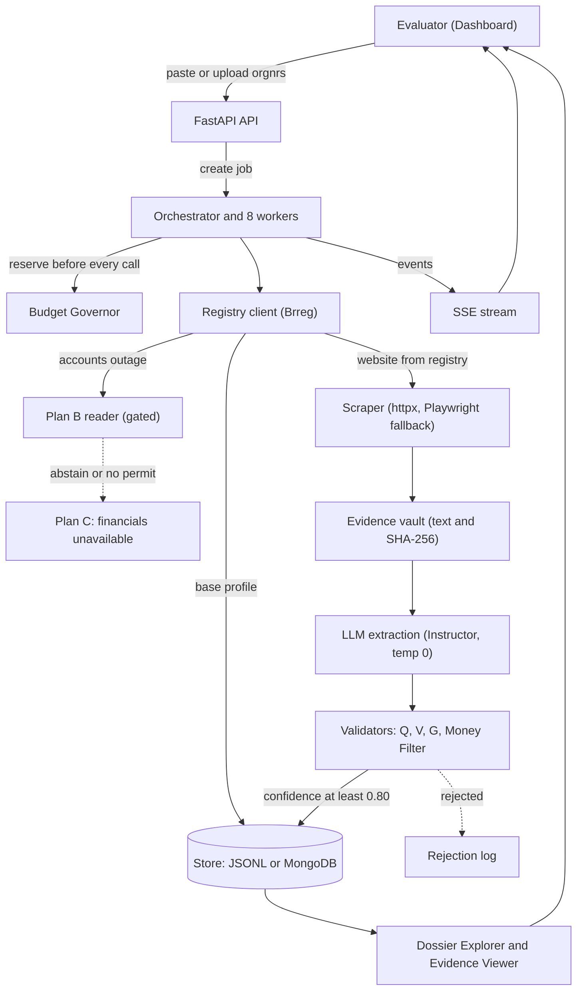

### D2 — User journey

**Explanation:** The evaluator's experience from upload to evidence inspection. Scores are subjective ratings for documentation purposes and are not measurements.

*Mermaid source.*

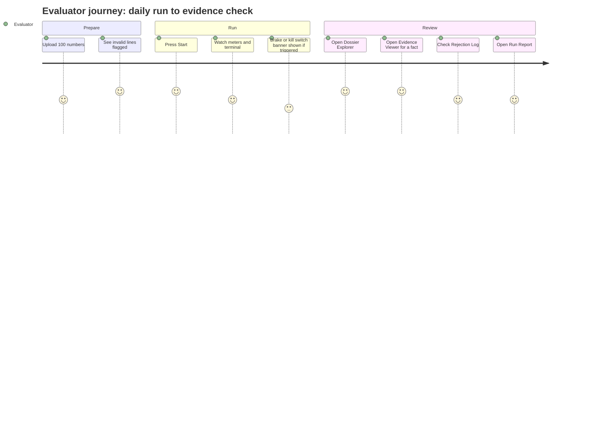

### D3 — Input validation flow

*Mermaid source.*

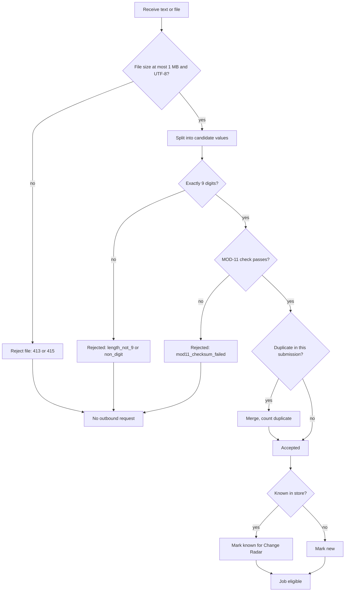

### D4 — Two-pass execution flow

*Mermaid source.*

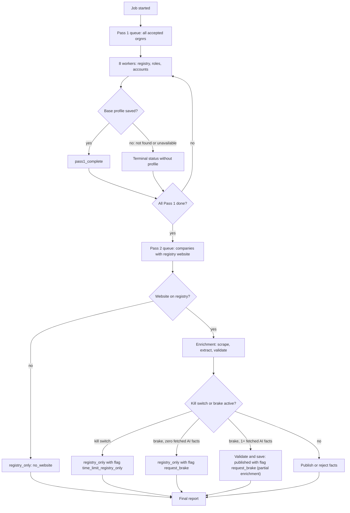

### D5 — Registry and financial fallback flow

*Mermaid source.*

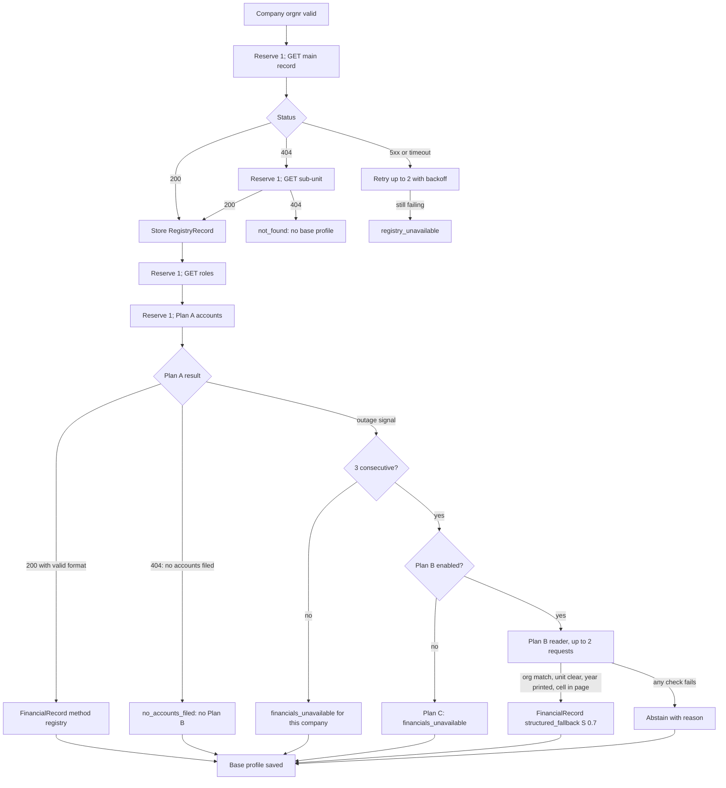

### D6 — Website extraction sequence

*Mermaid source.*

```mermaid
sequenceDiagram
    autonumber
    participant ORC as Orchestrator
    participant GOV as Governor
    participant SSRF as URL guard
    participant HX as httpx client
    participant PW as Playwright (fallback)
    participant EV as Evidence vault
    ORC->>GOV: reserve(website, 1)
    GOV-->>ORC: granted or denied
    ORC->>SSRF: validate registry URL
    SSRF-->>ORC: ok or rejected
    ORC->>HX: GET homepage (8 s timeout)
    alt timeout
    HX-->>ORC: timeout
    ORC->>GOV: reserve retry (1)
    ORC->>HX: retry (up to 2)
    else 403
    HX-->>ORC: 403 blocked
    Note over ORC: No evasion; robots respected
    else 200 with text
    HX-->>ORC: HTML
    ORC->>HX: follow redirect hop (each reserved, revalidated)
    ORC->>ORC: clean text, find About and Contact links (max 2)
    else empty page
    HX-->>ORC: empty body
    ORC->>GOV: reserve playwright page (5)
    GOV-->>ORC: granted only if kill switch off and cap not exceeded
    ORC->>PW: render (12 s, max 3 pages)
    PW-->>ORC: rendered text
    end
    ORC->>EV: save snapshot with SHA-256 and metadata
    EV-->>ORC: snapshot reference
```

### D7 — AI extraction and validation flow

*Mermaid source.*

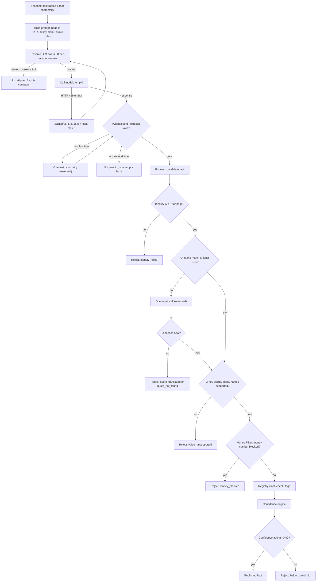

### D8 — Confidence decision tree

**Explanation:** Shows how the formula's components lead to the publish decision. Numbers in the tree are the manual's values (p.15). The table in TRD §11.8 gives the full arithmetic.

*Mermaid source.*

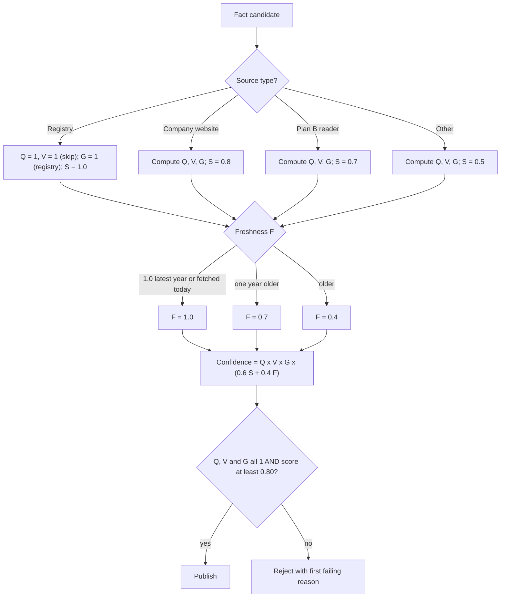

### D9 — Request emergency-brake flow

*Mermaid source.*

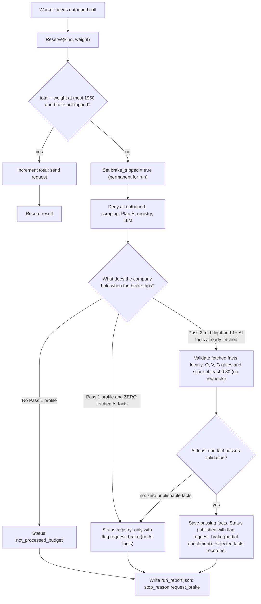

### D10 — Time kill-switch flow

*Mermaid source.*

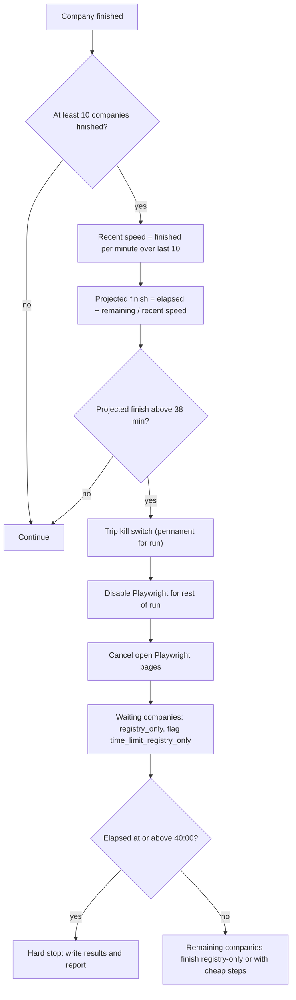

### D11 — Failure recovery flow

*Mermaid source.*

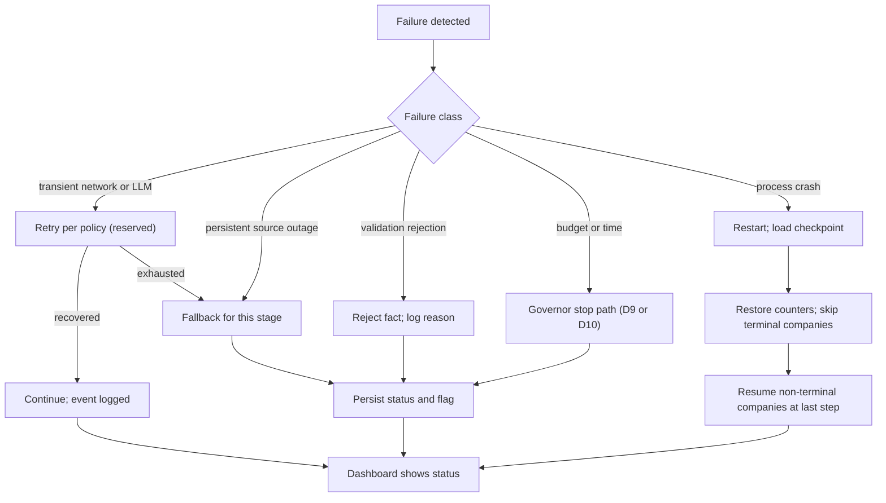

### D12 — Dossier publication flow

*Mermaid source.*

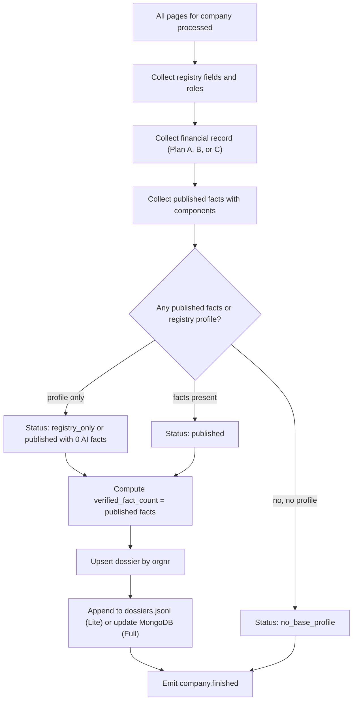

Note on verified_fact_count: counts AI-published facts only; registry fields are reported separately to avoid inflating the count (AS-15).

### D13 — Replay flow

*Mermaid source.*

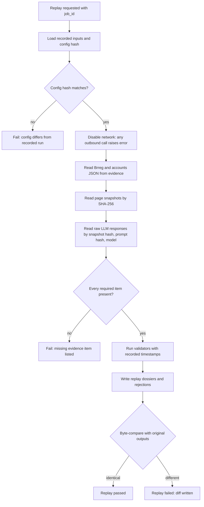

### D14 — Overall sequence diagram

**Explanation:** End-to-end view of one company across all actors, including the budget and kill-switch checks that gate outbound calls.

*Mermaid source.*

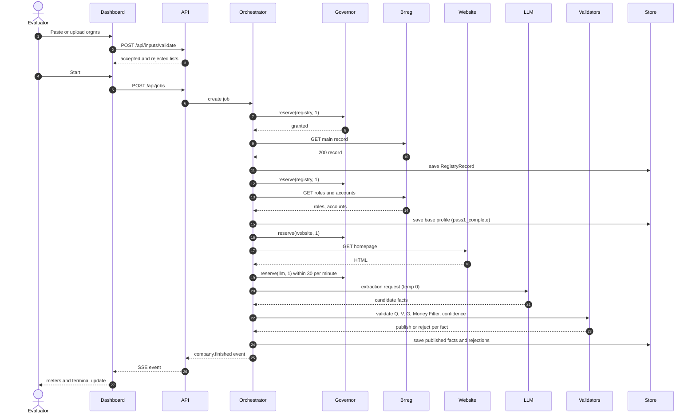

## 6. Overall sequence

The overall sequence is D14. Pass 1 steps precede Pass 2 for every company (F08 and D4). The kill switch and brake are checked at each reservation (D9, D10).

## Coverage check (Part 3 of the brief)

| **Brief flow**                  | **Where covered**          |
|---------------------------------|----------------------------|
| 1 Application startup           | F01                        |
| 2 Configuration validation      | F02                        |
| 3 Input submission              | F03                        |
| 4 TXT/CSV parsing               | F04                        |
| 5 Company-number validation     | F05                        |
| 6 Duplicate detection           | F06                        |
| 7 Job creation                  | F07                        |
| 8 Worker scheduling             | F08                        |
| 9 Pass 1 registry               | F09                        |
| 10 Financial-data processing    | F10, F11                   |
| 11 Pass 2 website extraction    | F12, F13, D6               |
| 12 AI-assisted extraction       | F14, D7                    |
| 13 Quote verification           | F15, D7                    |
| 14 Identity verification        | F16                        |
| 15 Money filtering              | F17                        |
| 16 Confidence calculation       | F18, D8                    |
| 17 Fact acceptance or rejection | F19                        |
| 18 Dossier publication          | F20, D12                   |
| 19 Evidence storage             | F21                        |
| 20 Live dashboard updates       | F22                        |
| 21 Change detection             | F23                        |
| 22 Budget exhaustion            | F24, D9                    |
| 23 Time kill switch             | F25, D10                   |
| 24 Emergency brake              | F26 (= F24 brake path), D9 |
| 25 Checkpoint recovery          | F27                        |
| 26 Replay execution             | F28, D13                   |
| 27 Final run report             | F29                        |
